# AI access

AI access monitoring answers one question: can the AI crawlers and answer engines you care about reach your site, and does what they find let your pages appear in their answers? It runs on every crawl, next to the SEO checks, and never touches the health score. There is no composite "GEO score" and no "citation probability": every finding says what was checked, what it rests on and where the operator documents it.

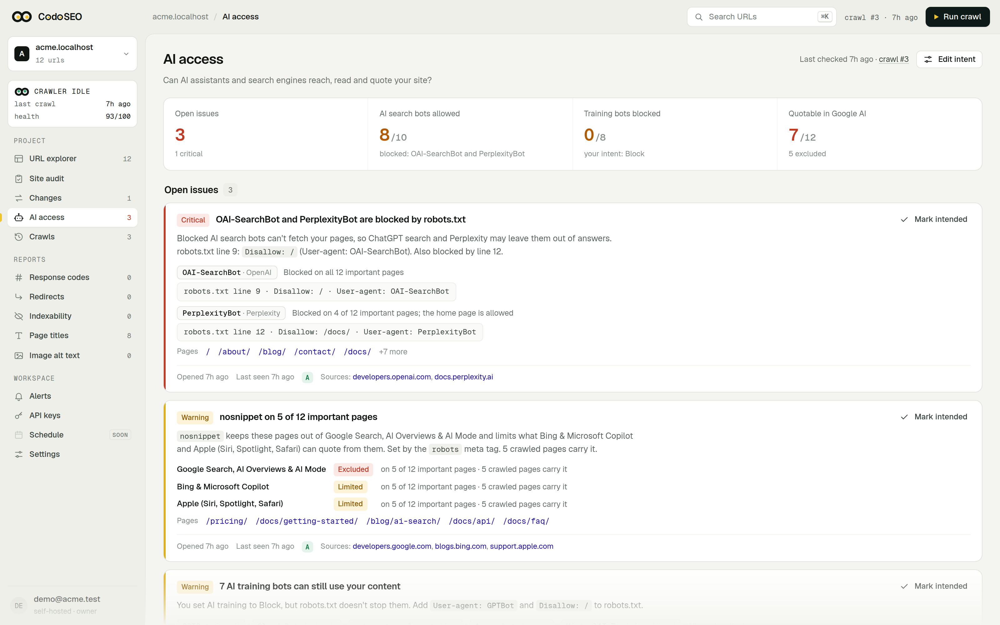

## What is checked

**robots.txt, per bot.** For each bot in the [registry](#the-public-registry) (OpenAI, Anthropic, Perplexity, Google, Apple, Meta, Amazon, Microsoft, DuckDuckGo, Mistral, Common Crawl and more) CodoSEO reads the group of your robots.txt that applies to its product token, applies the longest-match rule the way the operators describe, and records whether the home page and the other important pages are allowed, with the winning rule and its line. Important pages are the home page, the 20 most linked pages and any you star, up to 60. Control tokens such as `Google-Extended` never make requests but still decide what the operator may do, so they are listed too. Applebot, which Apple says follows Googlebot's rules when no group names it, is read that way. A robots.txt that answers 5xx or 429 is its own finding: crawlers are told to stay away until it recovers. One whose redirects never reach a file counts as missing, as RFC 9309 allows.

**Page-level controls, per engine.** For each of ten engines (Google Search, AI Overviews and AI Mode, Bing and Copilot, Apple, Amazon, ChatGPT, Claude, Perplexity, Meta AI, DuckDuckGo, Mistral) CodoSEO reads the controls that engine documents on each important page: the robots meta tag, `X-Robots-Tag` and `data-nosnippet`. Only controls the operator documents count, and only for the engines that honour them: `noarchive` removes a page from Copilot's answers, does nothing to Google's, and for Amazon means only "do not use for model training", so it is not counted there. A page is *eligible*, *limited* (a snippet cap, or a large share of its text under `data-nosnippet`) or *excluded*.

**Robots-only engines.** ChatGPT, Claude, Perplexity, Meta AI, DuckDuckGo and Mistral document no page-level control, so for them a page is always eligible and robots.txt is the only lever; the screen says so instead of implying a clean bill of health.

**Declared preferences, declared, not enforced.** `Content-Signal` and `Content-Usage` lines in robots.txt and response headers, and TDM reservation (`tdm-reservation` meta tag and header, `/.well-known/tdmrep.json`) are listed as the site states them. Nothing enforces them, and CodoSEO does not claim any bot honours them.

## Synthetic fetch checks

robots.txt can let a bot in while the CDN or firewall in front of the site turns it away: Cloudflare AI Crawl Control, DataDome, Akamai and the like decide by user agent before the request ever reaches your server. So after each monitored crawl CodoSEO fetches a few important pages with the user agents of the AI search and user-triggered bots, and compares each answer with what its own crawler gets for the same page at the same moment.

It is a **synthetic** check: the requests come from CodoSEO's address, not from the bots. The AI access screen shows the latest check, bot by bot, in its **Fetch check** section. Every result says it is synthetic: the badge on that section, "(synthetic check)" at the end of each finding title, `synthetic: true` in the JSON, and a banner in the CLI.

<table>
  <tr>
    <td width="50%"><a href="images/ai-access/ai-access-probes-light.png">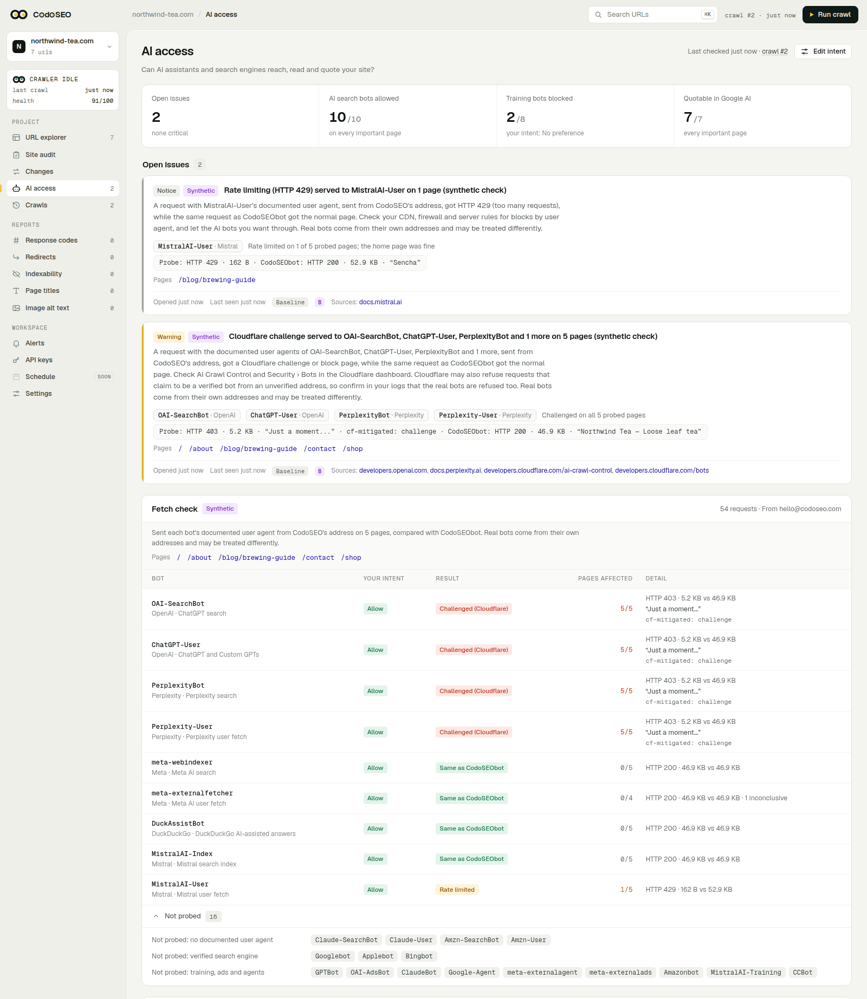</a><br>The Fetch check section and two synthetic incidents</td>
    <td width="50%"><a href="images/ai-access/intent-probes-light.png">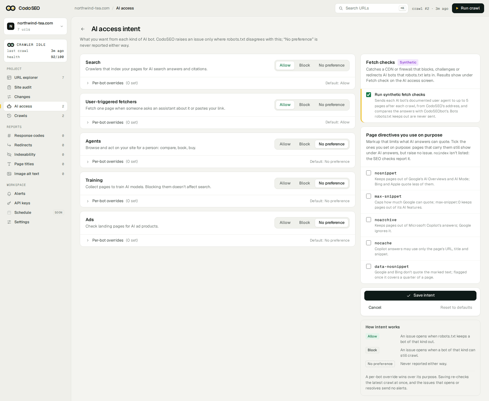</a><br>The switch under <b>Edit intent</b></td>
  </tr>
</table>

**What is sent.** Each bot's user agent exactly as its operator prints it on the page cited in the [registry](#the-public-registry), byte for byte, never assembled by CodoSEO. Every request also carries `From: hello@codoseo.com` (the RFC 9110 header for a contact address), so a site owner who sees a bot's user agent arriving from our address can reach us. Self-hosters can change it with `CODOSEO_PROBE_FROM` ([configuration.md](configuration.md#ai-access-probes)). There is no custom `X-` header: it would hand firewalls an easy way to wave the check through, and the user agent would no longer be what the bot sends.

**The baseline.** Each probed page is also fetched with CodoSEObot's own user agent, just before the bots, from the same address with the same client and headers. The user agent is the only difference, so a different answer is down to it. The baseline is not a browser user agent: a Chrome user agent from a datacenter address with a non-browser TLS stack is challenged by most bot managers, which would make the baseline itself unreliable, and it would mean pretending to be a person. Only pages CodoSEObot has just crawled as HTML 200 are probed, so the baseline is a known-good control.

**Who is probed.** The registry's search and user-triggered bots that make requests and whose operator documents a full user agent. Today that is nine: OAI-SearchBot, ChatGPT-User, PerplexityBot, Perplexity-User, meta-webindexer, meta-externalfetcher, DuckAssistBot, MistralAI-Index and MistralAI-User. Not probed, and listed as such:

- Claude-SearchBot and Claude-User: Anthropic's page names the tokens but prints no full user agent. Amzn-SearchBot and Amzn-User: Amazon prints only a template with a placeholder version. CodoSEO never makes up a user agent, so these are "Not probed: no documented user agent" until the operators print one.
- Googlebot, Bingbot and Applebot: bot managers verify these by reverse DNS and refuse a request that claims to be one from any other address, so a probe would always look blocked. They are search engines, not AI-specific, anyway.
- Agents, training and ads crawlers. Agents drive real browsers and sign their requests (Web Bot Auth) or come from published addresses; an unsigned copy of their user agent would measure the missing signature, not your policy.

Every probed bot is fetched whatever your intent, so a change of intent can re-evaluate from the stored results. Only bots whose intent is **Allow** become findings: a bot you want blocked, or have no preference about, being turned away is not reported.

**robots.txt and pacing.** A bot is never sent to a page robots.txt disallows for its token; the result says "Not probed: robots.txt". Probes run only when robots.txt gave verdicts, one request at a time on one connection, at least 500 ms apart, or the longest `Crawl-delay` among CodoSEObot and the probed tokens when that is longer (capped at 10 seconds, like the crawler).

**Retries and confirmation.** A 429, a 503, a timeout or a connection error is retried once, after `Retry-After` (at most 10 seconds; 2 seconds when there is none). A result worse than the baseline is fetched a second time the first time that bot meets that cause in a run; when the two fetches disagree the result is inconclusive ("the re-fetch disagreed"), not a finding. When the request cap or the time budget leaves no room for that second fetch, the result is inconclusive too ("no room left to confirm"): a grade B finding always rests on two fetches.

**How much.** Pages are taken in order: the home page, then starred pages, then the most linked, HTML 200 only. Bodies are read up to 256 KiB and never stored; only the status, size, media type, final URL, title (cut to 120 characters) and any challenge marker are kept.

| Plan | Pages probed | Requests per run (baseline, retries and confirmations included) | Time budget |
|---|---|---|---|
| No-signup audit | none | 0 | none |
| Free | 1 (the home page) | at most 30 | 45 s |
| Pro | 3 | at most 70 | 90 s |
| Agency | 5 | at most 120 | 120 s |
| Self-hosted | 5 (`CODOSEO_PROBE_URLS`, up to 10) | at most 160 | 180 s |

A page is started only when the requests left and the time left cover all of its requests, counting each request as the gap or the site's average answer time so far, whichever is longer; otherwise the run stops and says why ("time budget used up" or "request cap reached"). Slow answers on the last page can still run over, so a run is stopped outright a minute past its budget: the pages that finished are kept, the bots not yet answered on the page under way are inconclusive ("the time limit came first"), and the run says "time budget used up". Probes never run after a failed crawl, never touch the health score, and never fail a crawl: if anything goes wrong the report simply has no probes.

**Verdicts.** Each bot's answer is compared with the baseline; the first rule that matches wins.

| Verdict | When |
|---|---|
| Inconclusive | CodoSEObot itself got no HTML 200 page, or was challenged too; the bot's request got no response (a timeout); the confirming re-fetch disagreed; or there was no room left for it |
| Challenged | The bot got a bot-manager challenge or block page the baseline did not: Cloudflare, Vercel, AWS WAF, DataDome, HUMAN, Imperva, Akamai, Sucuri, or a generic CAPTCHA or "verify you are human" page. A CAPTCHA that is on the baseline too (a contact form) is the page's own and does not count |
| Rate limited | HTTP 429 |
| Blocked | Any other status from 400 (a 404 counts, as the baseline got the page), or the connection refused or dropped on both tries |
| Redirected | It ended at another URL than the baseline, ignoring the fragment, a trailing slash and an http→https upgrade |
| Different page | Both got a 2xx, the titles differ, and the bot's page is under half the size or has no title where the baseline has one: the misleading 200 |
| Same | Anything else. The same title at another size counts as the same: dynamic content, prerendering for bots, rotating blocks. So does a 2xx Markdown or plain-text answer (`text/markdown`, `text/plain`) where CodoSEObot got HTML: the site serves AI bots a text version on purpose |
| Not probed: robots.txt | robots.txt disallows the bot here, so it was not sent |

Each worse-than-baseline cause is one incident (`fetch_blocked`), for example `challenge_cloudflare`, `blocked_403`, `diverted`, `degraded` or `throttled`, with the bots it hit as members: another bot hitting the same cause widens the incident. Only bots the run could judge change an incident: a bot that is inconclusive on any page it was sent to (CodoSEObot got no usable page, no response, or the re-fetch disagreed) keeps what the incident last knew about it, so one bad run neither narrows, widens, resolves nor re-escalates it. An incident resolves when every bot it covers got a real verdict on every page and none has its cause. Its severity is Warning when a bot is affected on the home page and Notice otherwise; rate limiting and a different page are always Notice. It is never Critical, because a real bot from its own address may be treated differently. The incident cites each bot's documentation page and, for a challenge, the vendor's bot settings documentation, and says where to look next.

**What it can't see.** A synthetic probe changes the user agent, not the address or the signature, so it can be wrong in both directions:

- A site that blocks the real bots by IP range, or lets them in only on verified addresses, looks the same to our probes as to CodoSEObot. Such a block is invisible here.
- A site that lets bots in only when they come from their published addresses or sign their requests with Web Bot Auth refuses our copy while letting the real bot through.
- Cloudflare may refuse any request that claims to be a verified bot from an address that is not the bot's, whatever your AI Crawl Control settings say. A Cloudflare finding may therefore be our address being refused rather than the real bot, and its summary says to confirm in your logs.

Log evidence (milestone C1) is what will tell the two apart.

**Known limits.** Two cases the comparison can misread:

- A small prerendered page (under 32 KiB) that carries a reCAPTCHA, hCaptcha or Turnstile form, served to a bot while CodoSEObot gets a JavaScript app shell without the form, may read as a generic CAPTCHA challenge. The form's marker is only discounted when the baseline carries it too.
- Titles are read from the first 64 KiB of the page only. A page whose `<title>` comes later has no title for the comparison, so a different page is judged on size alone and may be missed, or a smaller page with a title read as different.

**Measured false positives.** The check is tested against a corpus of 23 fake sites that answer the way real servers, CDNs and bot managers do: a 403 by user agent, Cloudflare challenge and AI Crawl Control pages, DataDome, HUMAN "Press & Hold", Akamai, Imperva, Vercel, persistent and one-off 429s, geo-blocks and login walls that hit everyone, prerendering for bots, app shells, robots.txt rules, timeouts and maintenance pages. Probed with all nine bots, the 22 scored sites give 198 (site, bot) pairs: 50 true positives, 148 true negatives, **no false positives and no false negatives**, and no wrong cause. The 23rd, a block by IP address only, is listed as undetectable (its 9 pairs are not scored). The fixtures copy what the vendors really send, but they are fixtures: the real-world rate, Cloudflare above all, can be higher. Run it with:

```sh
cargo test -p codoseo-crawler --test probe_corpus -- --nocapture
```

**Switching it off.** The check is on by default for monitored sites. A site's owner can untick **Run synthetic fetch checks** under **Edit intent** on the AI access screen; from the next crawl no request is sent with an AI bot's user agent. A self-hosted install can set `CODOSEO_PROBE_URLS=0` (for the web and worker roles) to turn it off everywhere; the switch is then shown disabled and the AI access screen says fetch checks are turned off on this install. Open synthetic incidents stay open until fetch checks are turned back on or the issue is resolved: with the checks off nothing can judge them, so they are neither resolved nor updated. Anyone running a site can keep the check out: it follows robots.txt for each bot's token, and blocking `CodoSEObot` in robots.txt stops both the crawls and the probes. The [`/bot` page](https://codoseo.com/bot) explains this to site owners who see the requests.

## Content in raw HTML

OpenAI's GPTBot, Anthropic's ClaudeBot and PerplexityBot fetch a page's HTML and read it as it is: they don't run its JavaScript, as Vercel and MERJ measured in 2024 ([The rise of the AI crawler](https://vercel.com/blog/the-rise-of-the-ai-crawler)). The same operators' search and user-triggered fetchers (OAI-SearchBot, ChatGPT-User, Claude-SearchBot, Claude-User, Perplexity-User) were not part of that measurement; CodoSEO treats them the same way, and an incident's summary cites the measurement only for the crawlers it covered. A client-side app that sends an empty shell and builds the page in the browser is therefore a blank page to them, however good it looks to a visitor. So for each important page CodoSEO reads **the HTML as served** and says whether the content is in it. It never claims what the page looks like after rendering.

It costs no extra requests: the crawler already fetched these pages, and the verdict is drawn from what it read.

<table>
  <tr>
    <td width="50%"><a href="images/ai-access/ai-access-content-light.png">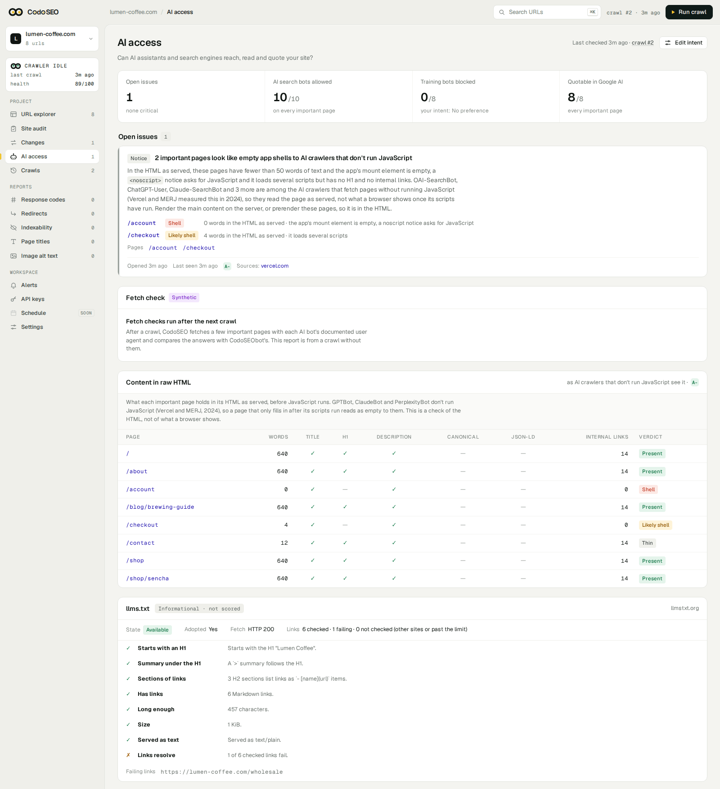</a><br>An incident for two shell pages, the <b>Content in raw HTML</b> card and the <b>llms.txt</b> card</td>
    <td width="50%"><a href="images/ai-access/ai-access-content-dark.png">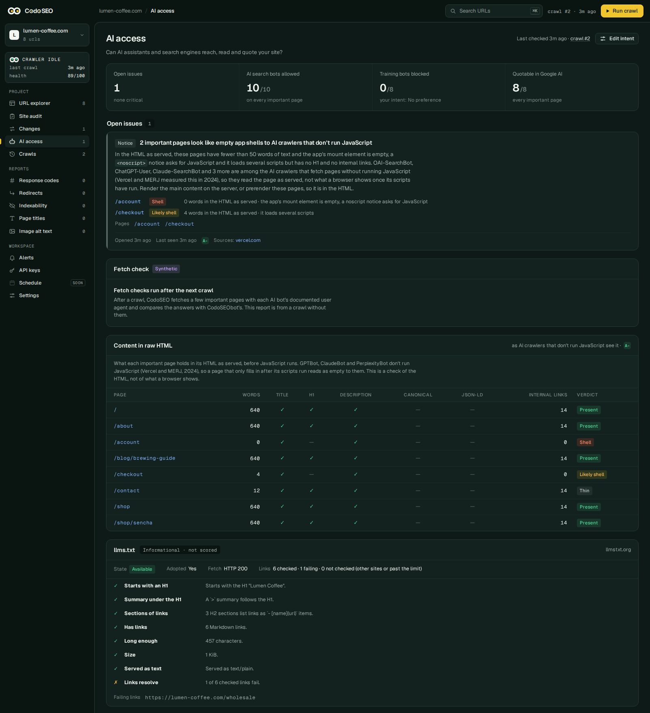</a><br>The same, dark theme</td>
  </tr>
</table>

**The verdicts.**

| Verdict | Means |
|---|---|
| **Shell** | Under 50 words of text in the HTML as served, and the app's mount element (a `div` or other container with id `root`, `app`, `__next` and the like, or `<app-root>`) is empty, or the page has no H1, a `<noscript>` notice asks for JavaScript, and it also has a mount element or is made of scripts (60% inline script, or 3 or more external scripts) |
| **Likely shell** | Under 50 words, no H1, no internal links, and scripts make up the page: inline script is at least 60% of its bytes, or it loads 3 or more external scripts (`<script src>` and `modulepreload` links) |
| **Thin** | Under 50 words but no shell signal: a contact or coming-soon page. Informational, never a finding |
| **Present** | 50 words or more in the HTML as served, whatever its scripts |

Script share alone never flags a page: a server-rendered Next.js page carries a large `__NEXT_DATA__` and its text as well. A `<noscript>` notice counts only on a page without an H1 and with a second sign of an app (a mount element or a page made of scripts), because a short post or note with a Disqus or form "enable JavaScript" notice is still a real page.

**What you see.** The AI access screen has a **Content in raw HTML** card. Its header counts the pages checked and the shells among them ("5 pages · 2 shells", likely shells included). Each page shows its verdict, the words found, whether the title, H1, description, canonical and JSON-LD are in the HTML as served, and its internal links; under a shell or likely-shell page a **Signals** line says in words what gave it away: the app's mount element is empty, a noscript notice asks for JavaScript, inline script makes up most of the page, or it loads several scripts. The API and MCP name the same signals as `mount_empty`, `noscript_js`, `script_heavy` and `many_scripts`. `codoseo check` prints the same facts for one page.

**The incident.** Shell or likely-shell important pages open one `content_missing` incident per site, with the pages as its members. It is **evidence grade A-**: read from the pages themselves, against a published measurement of how the bots fetch, not an operator's documentation of the page. Its summary starts with the fix (render the main content on the server, or prerender the page). It is raised only when at least one of the bots that don't render JavaScript (GPTBot, OAI-SearchBot, ChatGPT-User, ClaudeBot, Claude-SearchBot, Claude-User, PerplexityBot, Perplexity-User) is wanted under your intent and robots.txt lets it fetch a shell page. A page those bots may not fetch, or a bot you want blocked, raises nothing. Severity is Warning when the home page is a shell or half or more of the important HTML pages are, Notice otherwise. It is never Critical: the page may still reach people and search engines that render JavaScript. Only pages a crawl could judge change the incident: a shell page that answered an error, timed out or was not HTML this time keeps what the incident last knew about it, so one failed fetch neither resolves the incident nor reopens it a crawl later. A page that is no longer among the important pages leaves the incident. It resolves when every page it names was judged to have its content in the HTML (or thin), or left the important pages. The change kind `ai_content_missing` alerts at once by default.

**Measured.** The thresholds come from a corpus of real framework output (`crates/crawler/tests/content_corpus.rs`): 11 shells (Create React App, Vite + React, Vue CLI, Angular, Next.js and Gatsby client-only shells, Ember, SvelteKit CSR and more) and 16 normal pages (WordPress, server-rendered Next.js and Nuxt, Astro, Hugo, Docusaurus, a Shopify product, AMP, short pages such as a coming-soon page and a post and a note with Disqus, and short pages whose `<link>`, `` or SVG icons carry an id like `app` or `root`). It gives 10 true positives, 16 true negatives, **no false positives and no false negatives** on the scored pages. One shell is a **known false negative** and is not scored: Flutter web's default page, which is a single `flutter_bootstrap.js` script with no mount element, no notice and no inline script, and so looks like an image-only landing page with one analytics tag. Any shell that carries no mount element, notice or other marker will be missed the same way. Run it with:

```sh
cargo test -p codoseo-crawler --test content_corpus -- --nocapture
```

## llms.txt

`/llms.txt` is an optional, proposed file at the root of a site: a Markdown index of what an AI agent should read ([llmstxt.org](https://llmstxt.org/)). CodoSEO reports whether you serve one and how it holds up. It is **informational**: it is never scored, never part of the health score and never Critical, and a site without one has nothing to fix.

<table>
  <tr>
    <td width="50%"><a href="images/ai-access/ai-access-llms-light.png">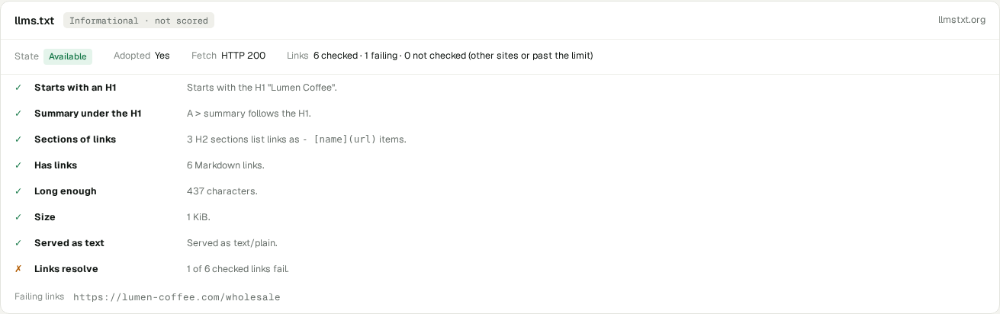</a><br>An available file with one failing link</td>
    <td width="50%"><a href="images/ai-access/ai-access-llms-absent-light.png">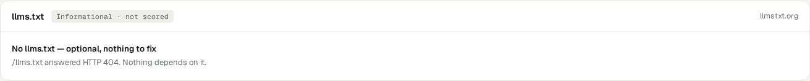</a><br>A site without one: nothing to fix</td>
  </tr>
</table>

**Status handling follows Lighthouse's `llms-txt` audit** ([documentation](https://developer.chrome.com/docs/lighthouse/agentic-browsing/llms-txt)):

| Answer | State |
|---|---|
| 2xx with a file | **Available** |
| 4xx except 429 | **No llms.txt**: not applicable, the file is optional |
| 2xx that serves an HTML page | **No llms.txt (soft 404)**: a web page where the file should be is the site's catch-all, so it is read like a 404 (Lighthouse takes a 2xx at face value) |
| 429, 5xx, another unexpected status, or no response at all | **Unavailable** |

The file is fetched once per crawl, as CodoSEObot, after robots.txt (a disallowed `/llms.txt` is not fetched, and the card says robots.txt keeps CodoSEObot off it), and read up to 512 KiB. A redirect is followed only where robots.txt allows the target: your robots.txt on your own site, the other site's own robots.txt off it. A 429, a 5xx or no answer is retried once, after the server's `Retry-After` (up to 5 seconds; a longer one is not waited for) or a second, so one blip doesn't read as a file that stopped serving. It is not fetched for the instant audits.

**The checks** on an available file. The format follows llmstxt.org; the last two Lighthouse-style rules are kept as they are in its audit:

- Starts with an H1 (the site's name; the only part the format requires; Lighthouse accepts an H1 anywhere).
- A `>` blockquote summary under the H1.
- At least one H2 section that is a file list of `- [name](url)` items (an `## Optional` section is noted as links an agent may skip).
- Has at least one Markdown link.
- Long enough: at least 50 characters.
- Size: at most 100 KiB and read whole (llmstxt.org wants it small enough to fit in context).
- Served as `text/plain` or `text/markdown`.
- Links resolve: every link that was checked answered 2xx or 3xx.

**Link checks.** Links to pages the crawl already fetched use that status. Other links on your own site get one request each after the crawl, with robots.txt applied and redirects not followed (a redirect counts as resolving), up to a cap that depends on the plan: **Free 5, Pro, Agency and self-hosted 20**. Links to other sites are not checked; the card counts them and the ones past the cap as not checked.

**The incident.** The one finding is `llms_txt_unavailable`, a Warning (grade A), and only after the site had adopted llms.txt, that is, an earlier report served the file and it now answers 5xx or 429 or not at all. A 404 or a soft 404 is a removal, not a failure, and a site that never had one gets nothing. The change kind `ai_llms_txt_unavailable` goes in the Monday digest, not in an instant alert. When the file serves again (or answers 404 because you removed it), the recovery is announced as an `ai_llms_txt_unavailable` change too, with "Resolved" as its new value, not as `ai_issue_resolved`: it follows the same alert rule as the failure, so you are never told at once about something you were only told in a digest.

## What is not checked yet

- Whether bots really visit: **log evidence** (which bots crawled you, verified by IP range) arrives later, in C1. Until then the fetch check shows what CodoSEO's own requests get, not what the real bots get.
- Whether any engine cites you. CodoSEO reports access, not outcomes.

## Evidence grades

Every finding carries a grade and links to its sources.

| Grade | Means |
|---|---|
| **A** | It rests on something the operator documents: robots.txt rules, page-level controls, the operator's own description of its bot. Every robots.txt, page-control, preference and `llms_txt_unavailable` finding is grade A. |
| **A-** | Read from your own pages and checked against a published measurement of how the bots fetch, rather than the operator's own documentation: the content in raw HTML verdicts (Vercel and MERJ, 2024: GPTBot, ClaudeBot and PerplexityBot don't execute JavaScript). Every `content_missing` finding is grade A-. |
| **B** | Observed by CodoSEO's synthetic fetch check: a request with the bot's documented user agent, compared with CodoSEObot's baseline for the same page at the same moment and, the first time, confirmed by a second fetch. Every `fetch_blocked` finding is grade B. |

## Intent

A blocked bot is a mistake or a choice, and only you know which. The intent model tells CodoSEO:

| Purpose | Default |
|---|---|
| AI search (OAI-SearchBot, PerplexityBot, Claude-SearchBot, ...) | Allow |
| User-triggered fetchers (ChatGPT-User, Claude-User, ...) | Allow |
| AI agents | No preference |
| AI training (GPTBot, ClaudeBot, Google-Extended, CCBot, ...) | No preference |
| Ads | No preference |

Set it per purpose, and override single bots, with **Edit intent** on the AI access screen of the web app (`/s/{site}/ai-access/intent`). Severity follows the intent: blocking GPTBot is nothing to report when you have no preference, and a warning or worse when you said you want training crawlers in. A bot you want blocked that can still crawl is reported too. A bot with no preference is never reported either way.

The same form has **Page directives you use on purpose**: tick `nosnippet`, `max-snippet`, `noarchive`, `nocache` or `data-nosnippet` when you set it deliberately, and pages that carry it still show in the AI answers table but raise no issue. `noindex` is not offered: the SEO checks report it.

The CLI and the local MCP server have nowhere to keep your intent, so `codoseo crawl` and `audit_site` judge under the defaults above. The hosted MCP server and the REST API report the incidents drawn under the intent you saved.

## Incidents and alerts

The web app turns findings into incidents that open when a crawl first sees a problem and resolve when a later crawl no longer does. The AI access screen lists the open ones, and the changes page and alerts use eight change kinds for them:

| Kind | Meaning |
|---|---|
| `ai_bot_blocked` | Bots you want are kept out by robots.txt, or robots.txt fails |
| `ai_answers_restricted` | Page markup takes pages out of an engine's AI answers |
| `ai_block_not_applied` | A bot you want blocked can still crawl the site |
| `ai_fetch_blocked` | The synthetic fetch check saw a bot you want challenged, blocked, redirected, rate limited or served a different page, while CodoSEObot got the normal one |
| `ai_content_missing` | Important pages are empty app shells in their HTML as served, to the AI crawlers that don't run JavaScript |
| `ai_llms_txt_unavailable` | A `/llms.txt` the site served before now fails (5xx, 429 or no answer) |
| `ai_issue_resolved` | An AI access incident is gone (except `llms_txt_unavailable`, whose recovery is an `ai_llms_txt_unavailable` change) |
| `ai_preferences_changed` | Your declared Content-Signal, Content-Usage or TDM preferences changed |

They are in the alert settings grid like any other kind, so email, Slack, Discord and webhook alerts work for them. By default `ai_bot_blocked`, `ai_answers_restricted`, `ai_fetch_blocked`, `ai_content_missing` and `ai_issue_resolved` alert at once; the other three (`ai_block_not_applied`, `ai_preferences_changed`, `ai_llms_txt_unavailable`) wait for the Monday digest. An alert whose changes are all AI access ones links to the AI access screen. A crawl that failed on robots.txt is not a finished crawl, so its incident shows on the AI access screen and in alerts, not on the changes page.

**The first check is quiet.** The incidents opened by the first report that could judge them are your baseline: they are listed but write no changes and send no alerts, so turning the feature on (or a site whose first crawls failed) does not fire a storm. Changing your intent re-evaluates quietly the same way. An open incident that gets worse, or names another bot or engine, writes a change again.

**A failing robots.txt is checked twice.** A crawl stopped by a robots.txt that answers 5xx or 429 is retried 15 minutes later, like any failed crawl; the incident is recorded only when the retry fails too, so a short blip says nothing. Its alert then stands in for the generic "couldn't reach your site" one.

**Mark intended** on an incident says "this is what I want" and changes your intent just enough:

- a bot blocked on the home page is set to Block, so you hear if it can crawl again;
- a bot blocked on some pages only is set to No preference (Block would report it as getting in), and so is a bot you wanted blocked that still gets in;
- a page directive such as `nosnippet` joins the directives you use on purpose. The engines' crawlers keep their stance, so robots.txt is still watched for Googlebot, Bingbot and the rest.

It then re-evaluates quietly, the incident resolves as a choice instead of a fix, and the notice says how many issues resolved or opened.

## The public registry

The list of bots behind all this is public at `/ai-bots` (a searchable table) and `/ai-bots.json` (the data), on codoseo.com and on every self-hosted install, no login needed. The data file is licensed **CC0-1.0**: use it for anything, no attribution needed. Each bot has its robots.txt token, operator, product, purpose, whether the operator says it honours robots.txt, the operator's IP-range file and verification hints where published, the source page it was checked against, and the date it was last reviewed.

To propose a change, open a pull request against [SafrowLabs/CodoSEO](https://github.com/SafrowLabs/CodoSEO) editing `crates/geo/data/ai-bots.json`. Cite an operator-owned page in `source_url`, never a third-party directory, and update `last_reviewed` and `updated`. `cargo test -p codoseo-geo` lints the file; the field list is in `crates/geo/data/README.md`.

## Using it

### CLI

```sh
# The registry
codoseo bots
codoseo bots --format json > ai-bots.json   # the file exactly as published

# What robots.txt says to each bot for a path, and the declared preferences
codoseo robots https://example.com/ --path /pricing
```

```
AI bots (path /pricing)
  Token          Operator   Purpose     Verdict
  GPTBot         OpenAI     training    Blocked  line 2
  OAI-SearchBot  OpenAI     search      Allowed
  ChatGPT-User   OpenAI     user fetch  Allowed  may ignore robots.txt
  ...
  Content-Signal (line 6): search=yes, ai-train=no
```

`--format json` adds `bots` (token, operator, purpose, `honours_robots`, `allowed`, `line`, `rule`) and `declared` to the existing fields.

`codoseo check` prints a **Raw HTML content** block for the page: the verdict, the words found, whether the title, H1, description, canonical and JSON-LD are in the HTML as served, the internal links, the scripts and any shell signals, with a note that GPTBot, ClaudeBot and PerplexityBot don't run JavaScript. `codoseo llms-txt` fetches a site's `/llms.txt` after its robots.txt and prints the [checks](#llmstxt); it is informational and never scored:

```sh
codoseo llms-txt https://example.com/
codoseo llms-txt https://example.com/ --format json   # table (default), json or markdown
```

It exits 0 whatever the file holds, including no file. It exits 2, like any command that could not do its job, when robots.txt disallows CodoSEObot on `/llms.txt`, robots.txt can't be read, the address is refused, or the 30-second budget runs out; nothing is checked then.

`codoseo crawl` adds an **AI access** section to the table and markdown reports, and an `ai_access` object (`report` and `findings`, judged under the default intent) to the JSON audit. The audit's `format_version` stays 1; older audit files load and diff as before. `--fail-on` looks only at the SEO checks.

A plain `codoseo crawl` sends no request as an AI bot. `codoseo probe` runs the [synthetic fetch check](#synthetic-fetch-checks) on one page, now, from your machine; `--bots` limits it to some tokens (any case, comma-separated). It takes at most two minutes, robots.txt included; past that it stops and prints what it has, the bots it did not reach marked inconclusive:

```sh
codoseo probe https://example.com/pricing
codoseo probe https://example.com/ --bots OAI-SearchBot,PerplexityBot --format json
```

```
SYNTHETIC CHECK. Requests sent from this machine with each bot's documented user agent and compared with CodoSEObot's. Real bots come from their own addresses and may be treated differently.

URL       https://example.com/pricing
Baseline  CodoSEObot · HTTP 200 · 5086 bytes · "Pricing - Example"
From      hello@codoseo.com
Requests  13

Bot                   Result                   Status  Bytes  Title
OAI-SearchBot         Same as CodoSEObot       200     5086   Pricing - Example
PerplexityBot         Challenged (Cloudflare)  403     123    Just a moment...
meta-webindexer       Blocked (403)            403     65     Forbidden
...

Not probed
  Claude-SearchBot: no documented user agent
  Googlebot: verified search engine
  ...

Findings (default intent)
  Notice    HTTP 403 served to meta-webindexer on 1 page (synthetic check)
  Notice    Cloudflare challenge served to PerplexityBot and Perplexity-User on 1 page (synthetic check)
```

`codoseo crawl --probes` does the same for up to 5 important pages after the crawl, with the self-hosted budget, and puts the results in the report's `ai_access` section (`report.probes`, plus the `fetch_blocked` findings). Both read robots.txt first and honour it for each token, and both send `From: hello@codoseo.com` unless `CODOSEO_PROBE_FROM` is set.

### Local MCP

`audit_site` saves the same `ai_access` section as `codoseo crawl` in the cached audit, under the default intent. `check_ai_access` takes a `url` and fetches its robots.txt and the page right now. It returns a short `summary`, every registry bot's verdict for the path (`token`, `operator`, `purpose`, `allowed`, `line`, `rule`), the declared preferences, and for each engine the page's effect (`eligible`, `limited` or `excluded`) with its causes. `probe_ai_fetch` runs the synthetic fetch check on one `url` (optionally only some `bots`), like `codoseo probe`; its summary starts "Synthetic check:". `audit_site` never probes. `check_ai_access` also returns `content`, the page's raw HTML verdict, words, signals and metadata facts; `check_llms_txt` takes a `url`, fetches `/llms.txt` on its site after robots.txt and returns the state, the checks and the link summary (informational). See [mcp.md](mcp.md).

### Hosted MCP and REST

`get_ai_access` (MCP) and `GET /api/v1/sites/{site}/ai-access` (REST) return the latest report of one of your sites and its open incidents:

```sh
curl -H "Authorization: Bearer cdo_..." https://codoseo.com/api/v1/sites/{site}/ai-access
```

```json
{
  "site_id": "…",
  "checked_at": "2026-10-09T06:12:44Z",
  "crawl_id": "…",
  "robots": { "status": 200, "availability": "ok" },
  "open_incidents": [
    { "id": 12, "kind": "bots_blocked", "subject": "search", "severity": "critical",
      "title": "OAI-SearchBot is blocked by robots.txt", "summary": "…",
      "opened_at": "…", "last_seen_at": "…" }
  ],
  "bots": [
    { "token": "OAI-SearchBot", "operator": "OpenAI", "purpose": "search", "intent": "allow",
      "home_allowed": false, "important_blocked": 3, "important_total": 3, "conflicts": true }
  ],
  "engines": [
    { "id": "google", "name": "Google Search, AI Overviews & AI Mode",
      "eligible": 3, "limited": 0, "excluded": 0, "page_controls": true }
  ],
  "declared": {
    "content_signals": [], "content_usage": [],
    "headers": { "content_signal": [], "content_usage": [], "tdm_reservation": null, "tdm_policy": null },
    "tdm_meta": { "reservation": null, "policy": null }, "tdmrep": null, "home_read": true
  }
}
```

The response also has `content` (the [raw HTML content](#content-in-raw-html) of the important pages, at most 30 listed with `more` for the rest) and `llms_txt` (the [llms.txt](#llmstxt) report), both described in [api.md](api.md#content-and-llmstxt-in-ai-access) and left out of reports from before they existed. Before a site has a report, `checked_at` is `null` and `note` says it appears after the next crawl. The response also has `probes_enabled` and `probes`, the latest synthetic fetch check per bot, described in [api.md](api.md#the-synthetic-fetch-check-in-ai-access); its incidents are in `open_incidents` with kind `fetch_blocked`. The call counts once against the daily allowance like any other ([api.md](api.md)).

## Screenshots

<table>
  <tr>
    <td width="50%"><a href="images/ai-access/ai-access-light.png">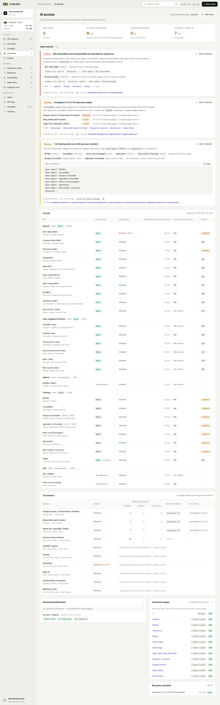</a><br>The AI access screen</td>
    <td width="50%"><a href="images/ai-access/ai-access-dark.png">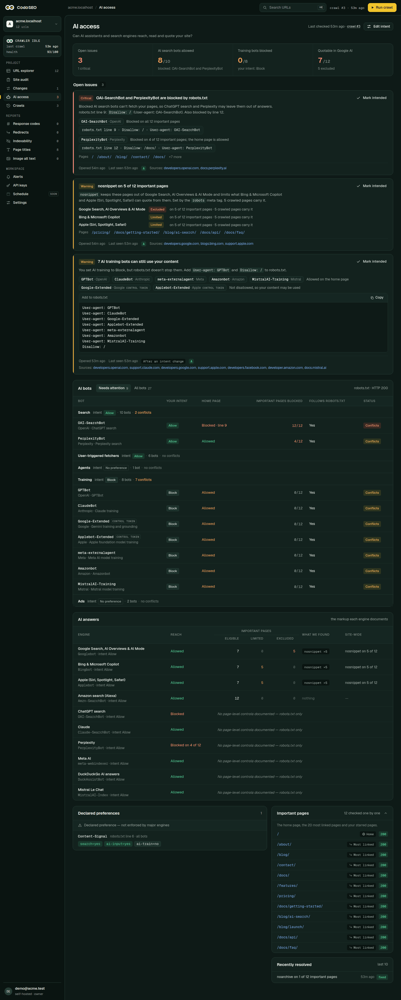</a><br>The same, dark theme</td>
  </tr>
  <tr>
    <td><a href="images/ai-access/ai-access-content-mobile.png">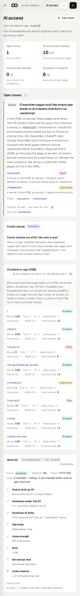</a><br>Content and llms.txt on a phone</td>
    <td><a href="images/ai-access/ai-access-probes-clear-light.png">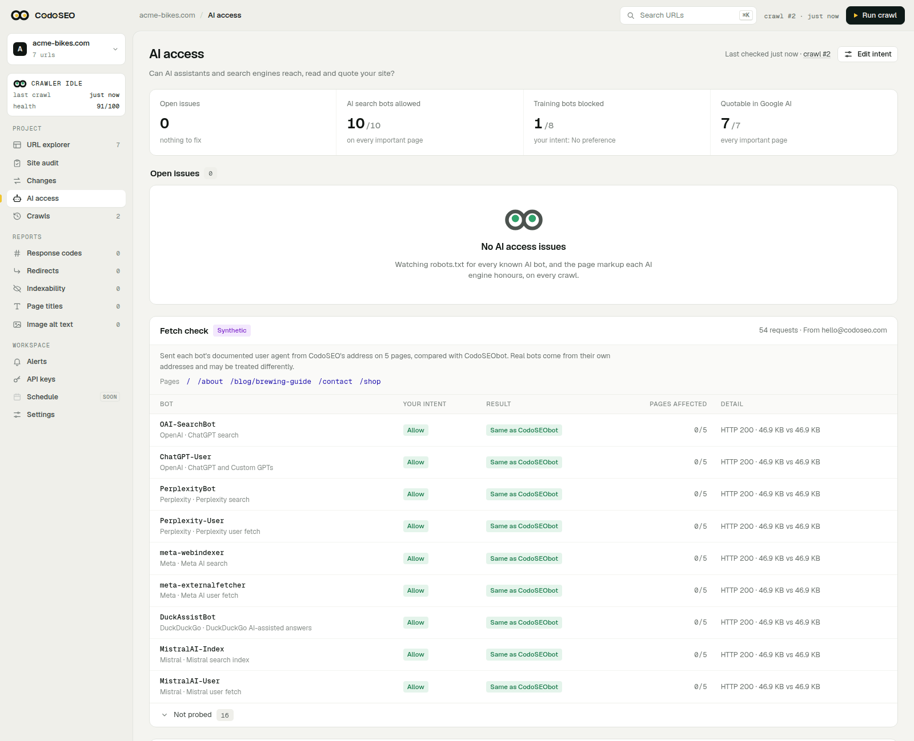</a><br>The Fetch check with every probe clear</td>
  </tr>
  <tr>
    <td><a href="images/ai-access/intent-light.png">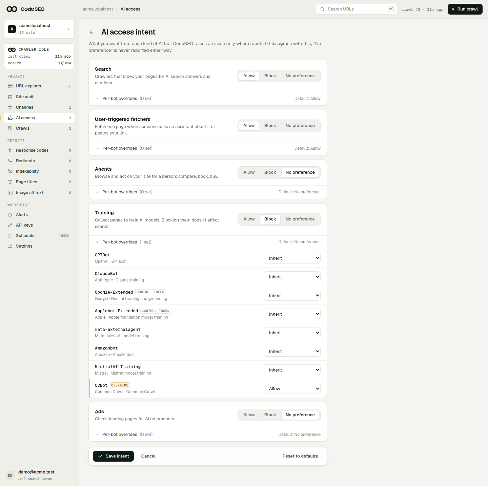</a><br>The intent form</td>
    <td><a href="images/ai-access/ai-access-mobile.png">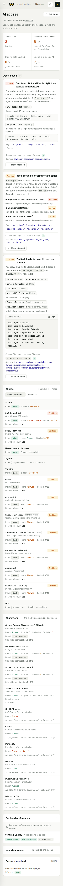</a><br>On a phone</td>
  </tr>
  <tr>
    <td><a href="images/ai-access/changes-light.png">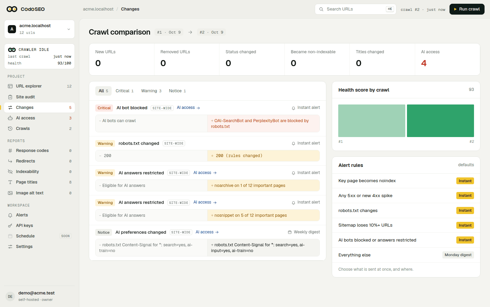</a><br>AI access changes on the changes page</td>
    <td><a href="images/ai-access/ai-access-empty.png">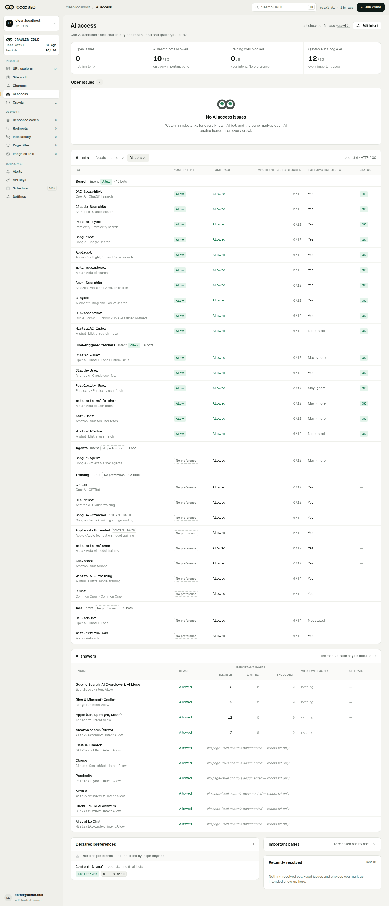</a><br>Before the first crawl</td>
  </tr>
  <tr>
    <td><a href="images/ai-access/ai-bots-light.png">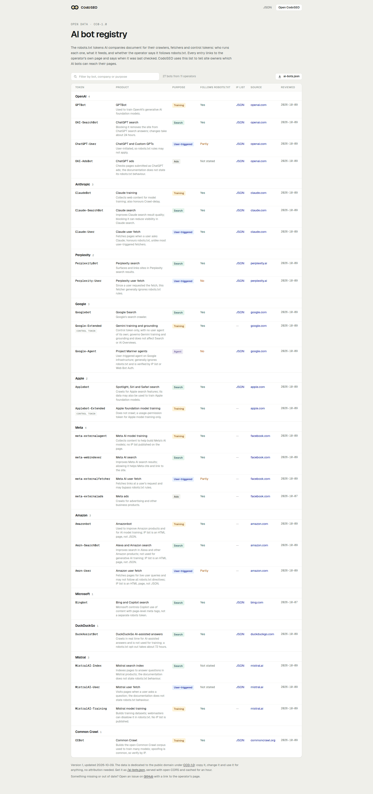</a><br>The public AI bot registry at <code>/ai-bots</code></td>
    <td></td>
  </tr>
</table>
